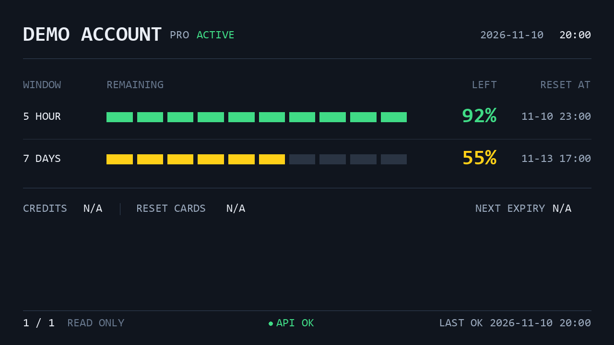

# AuxDisp

[简体中文文档](docs/zh/README.md) | [English](docs/en/README.md)

AuxDisp 为 USB / 串口辅助显示屏提供 Python 驱动和现成应用。你可以自己绘制小型信息屏，也可以安装 **auxdisp-codex-quota**，在桌面辅助屏上轮播多个 Codex 账户的剩余额度。

## 界面预览



**Demo，合成账户，非实机照片。** 图片由当前渲染器离线生成，不包含真实账户信息。[来源与重现方法](docs/assets/README.md)。目前没有可公开使用的实机运行照片，后续补充。

## 能做什么

- **auxdisp-driver**：保留八类驱动实现（含模拟器），通过 USB 或串口发送 Pillow 图像，设置设备支持的亮度和方向，并使用设备专用 API。
- **auxdisp-codex-quota**：显示多账户的 5 小时 / 7 天剩余额度、重置时间、日期和时钟；默认 15 秒轮播、60 秒采集。
- 采集异常时保留历史数据并提示状态，USB 断开后自动重连；Windows 支持后台运行及 CLI 启停管理。

显示重置卡数量及每张卡的到期时间和剩余时长；额度窗口同时显示重置倒计时。缺失数据保留为 `N/A`。应用只读取额度，不自动切换账户、使用重置卡、购买额度或修改认证信息。

## 选择项目

| 项目 | 适用人群 | 作用与安装来源 |
|---|---|---|
| [auxdisp-driver](packages/auxdisp-driver/README.md) | Python 开发者 | 控制辅助显示设备 · [PyPI](https://pypi.org/project/auxdisp-driver/) |
| [auxdisp-codex-quota](apps/auxdisp-codex-quota/README.md) | Codex 用户 | 在辅助屏上显示额度 · [PyPI](https://pypi.org/project/auxdisp-codex-quota/) |

两个包的 0.1.0 均已发布。安装应用会自动从 PyPI 安装驱动依赖，无需分别下载源码。

## 快速开始

### 直接使用 auxdisp-codex-quota

前置条件：**Windows、Python 3.11+**，已安装并配置当前用户账户的 [codex-auth](https://github.com/Loongphy/codex-auth)，以及可访问的 **Turing USB 5.2 英寸**屏幕（VID `0x1CBE` / PID `0x0050`，横屏 1280×720）。Windows 需要为该设备正确配置兼容的 USB 接口驱动；Python 包不会替换系统驱动。

```powershell
pip install auxdisp-codex-quota
auxdisp-codex-quota start
auxdisp-codex-quota status
auxdisp-codex-quota stop
```

安装不会注册任务；首次 `start` 才注册并启动当前用户的计划任务。关闭终端后可继续运行，仅在该用户登录期间运行。`stop` 同时禁用登录启动和崩溃重试，再次 `start` 可恢复。[后台运行与更新](apps/auxdisp-codex-quota/docs/zh/background.md)。

没有设备或账户也能先看离线 Demo：

```powershell
auxdisp-codex-quota --preview preview.png
```

不再使用时，先停止并注销任务，再卸载包；配置和日志会保留：

```powershell
auxdisp-codex-quota stop
auxdisp-codex-quota uninstall-service
pip uninstall auxdisp-codex-quota
```

### 用 auxdisp-driver 开发信息屏

需要 Python 3.9+ 以及与所选协议匹配的设备：

```powershell
pip install auxdisp-driver
```

下面的 Turing USB 示例绘制并发送 Pillow 图像，退出时自动释放设备：

```python
from PIL import Image, ImageDraw
from auxdisp_driver import Orientation, open_display

with open_display("turing_usb", orientation=Orientation.LANDSCAPE) as display:
    display.set_brightness(30)
    image = Image.new("RGB", (display.width, display.height), "navy")
    ImageDraw.Draw(image).text((24, 24), "Hello AuxDisp", fill="white")
    display.show(image)
```

[设备选择、发现和专用 API](packages/auxdisp-driver/README.md)。

## 硬件与系统支持

auxdisp-driver 包含 Rev A/B/C/D、Turing USB、WeAct A/B 和模拟器。**包含协议代码不等于实机验收通过。** 已有 Turing USB 5.2 英寸清屏修复记录，完整 Windows 硬件矩阵仍待验收；其他型号不能据代码覆盖推断可用。详见[设备与验收范围](packages/auxdisp-driver/docs/zh/supported-devices.md)。

驱动可在 Windows、Linux、macOS 环境安装，但设备权限、后端和型号兼容性需要分别验证。`libusb-package` 提供用户态 libusb 库，与 Windows 设备接口驱动不同；Linux 还需要设备访问权限。auxdisp-codex-quota 的后台管理面向 Windows，其他系统的离线预览不代表 USB 或后台功能通过验收。

## 配置

应用默认读取 `%LOCALAPPDATA%\auxdisp-codex-quota\config.toml`，可用 `--config` 指定其他文件。常用选项包括亮度（默认 30%）、轮播间隔（15 秒）、采集间隔（60 秒）、字体文件和按稳定账户 ID 配置的特殊额度策略。修改后执行 `auxdisp-codex-quota restart`。[配置指南](apps/auxdisp-codex-quota/docs/zh/usage.md)。

## 遇到问题

| 症状 | 先检查 |
|---|---|
| 找不到 CLI | Python 安装环境及 Scripts 目录的 PATH |
| 找不到 codex-auth | 在同一用户终端确认命令可用，必要时配置原生 exe 的绝对路径 |
| USB 无法识别 | 型号、VID/PID、线缆、接口驱动与设备访问权限 |
| 已连接但无画面 | `status` 的进程和 USB 状态、前台 `run` 日志及亮度 |
| API ERROR / STALE | codex-auth 的只读查询、网络和账户刷新状态 |
| UNAVAILABLE | 数据源是否提供该周期；缺失不等于额度为零 |
| 后台启动失败 | 计划任务策略、安装解释器及用户日志 |
| 不清楚启停状态 | `start` 启动、`status` 检查、`stop` 停止并禁用自动启动 |

详见[应用排障](apps/auxdisp-codex-quota/docs/zh/troubleshooting.md)和[驱动使用指南](packages/auxdisp-driver/docs/zh/usage.md)。仍有问题可提交 [Issue](https://github.com/pkuimyy/auxdisp/issues)，请先删除账户标识和凭据。

## 开发与贡献

项目采用 Monorepo，两个 Python 包独立发布，使用 uv 管理各自的开发环境。欢迎 Issue 和 Pull Request。[本地开发](docs/zh/development.md) · [架构](docs/zh/architecture.md)。

## 来源与许可证

驱动主要源自 Matthieu Houdebine 及贡献者的 [turing-smart-screen-python](https://github.com/mathoudebine/turing-smart-screen-python)。[smartscreen-driver](https://github.com/hchargois/smartscreen-driver) 仅用于参考 API 与打包组织。详见 [NOTICE](packages/auxdisp-driver/NOTICE.md) 和 [GPL-3.0-or-later 许可证](LICENSE)。

[codex-auth](https://github.com/Loongphy/codex-auth) 是独立项目，提供账户额度数据。AuxDisp 是社区项目，并非 OpenAI 官方产品。
