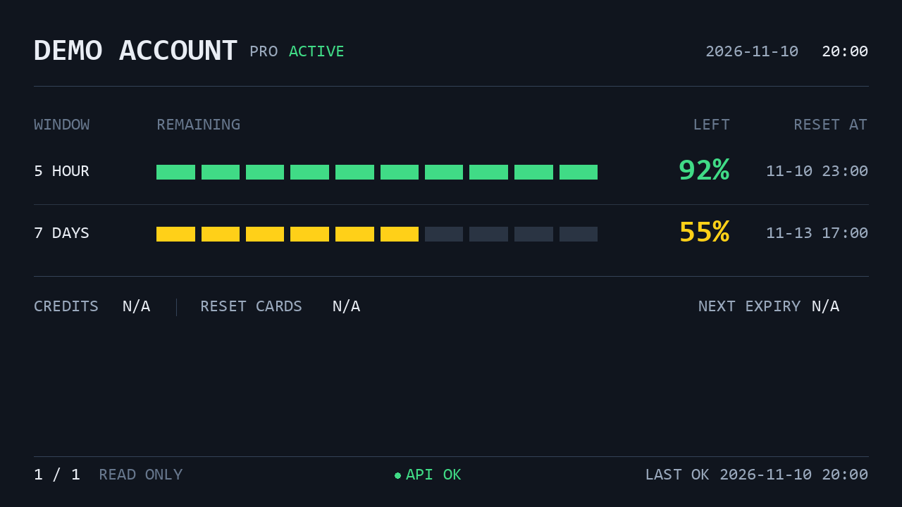

# auxdisp-codex-quota

[English version](https://github.com/pkuimyy/auxdisp/blob/main/apps/auxdisp-codex-quota/docs/en/README.md)

把多个 Codex 账户的剩余额度放到桌面辅助屏上：自动轮播 5 小时 / 7 天额度、重置时间、日期与时钟。面向 Windows 和 Turing USB 5.2 英寸屏幕，安装后通过 CLI 管理，无需源码目录。

## 界面预览



**Demo：合成账户的 1280×720 离线预览，不是实机照片。** 由当前渲染器生成，没有真实账户信息。 [来源与重现](https://github.com/pkuimyy/auxdisp/blob/main/docs/assets/README.md).

## 功能

- 多个账户自动轮播，默认每 15 秒切换；每 60 秒调用一次只读采集。
- 5 小时 / 7 天剩余额度百分比、10 格进度条、重置时间和固定日期时钟。
- 整体或单账户采集失败时保留历史数据，显示 API ERROR / STALE；USB 自动重连。
- Windows 当前用户后台任务、单实例与 CLI 启停；无需设备的离线预览与 PNG 输出。

应用只运行 `codex-auth list --api --json`，不自动切换账户、消耗 Reset Cards、购买额度或修改认证信息，也不读取或保存认证令牌。codex-auth 的缓存与认证管理由该独立工具负责。

## 使用条件

- **Windows + Python 3.11+**，后台任务需要该用户保持登录；不以 SYSTEM 或管理员身份运行。
- [codex-auth](https://github.com/Loongphy/codex-auth) 已独立安装，当前用户已添加账户，并支持 JSON API schema 1。先在终端验证 `codex-auth list --api --json`；输出含账户信息，请勿公开。npm 安装命令及登录方法见该项目说明。
- **Turing USB 5.2 英寸**：VID `0x1CBE` / PID `0x0050`，固定横屏 1280×720。Windows 已正确配置可访问设备的 USB 接口驱动。

`auxdisp-driver` 与用户态 libusb 依赖会自动安装；它们不会安装或替换 Windows 的设备接口驱动。仅查看离线 Demo 时不需要账户或设备。

## 安装

0.1.0 已发布到 [PyPI](https://pypi.org/project/auxdisp-codex-quota/):

```powershell
pip install auxdisp-codex-quota
```

使用希望长期保留的 Python 环境；删除该环境会使后台任务失效。安装只添加包和 CLI，不自动注册任务。

## 快速开始

```powershell
auxdisp-codex-quota start
auxdisp-codex-quota status
auxdisp-codex-quota stop
```

首次 `start` 注册并启动当前用户任务。配置未创建时使用默认值：亮度 30%、15 秒轮播、60 秒采集。`status` 返回 JSON；`process_running` 与 `usb_connected` 分开报告，进程运行不等于屏幕已连接。

没有设备时可先生成合成数据预览，或运行 60 秒离线轮播：

```powershell
auxdisp-codex-quota --preview preview.png
auxdisp-codex-quota run --demo --headless latest.png --duration 60
```

前台调试用 `auxdisp-codex-quota run`，Ctrl+C 退出；无子命令也等同于 `run`。Windows 前台和后台共享单实例锁，需要先 `stop` 后前台调试。

## 后台运行与更新

| 命令 | 行为 |
|---|---|
| `start` | 注册或更新本用户任务并启动，重复调用不创建第二实例 |
| `status` | 查看注册、启用、进程、USB 和最近成功采集时间 |
| `stop` | 禁用登录启动和崩溃重试，再停止当前实例 |
| `restart` | 停止后重新启动，重新加载配置 |
| `uninstall-service` | 停止并注销本用户任务，保留配置和日志 |

关闭终端后后台可继续运行；任务在当前用户登录时启动，不是开机即运行的系统服务。真实任务注册、登录/休眠恢复、电池行为和长期运行仍待系统验收。

更新时先停止，升级同一 Python 环境中的包，再启动：

```powershell
auxdisp-codex-quota stop
pip install --upgrade auxdisp-codex-quota
auxdisp-codex-quota start
```

仅升级包不会重启已运行进程；若已在运行中完成升级，执行 `restart`。修改配置后也应 `restart`。显式配置文件请在 `start` / `restart` 时重复传入 `--config`。 [后台详情、日志与恢复](https://github.com/pkuimyy/auxdisp/blob/main/apps/auxdisp-codex-quota/docs/zh/background.md).

## 配置

默认文件： `%LOCALAPPDATA%\auxdisp-codex-quota\config.toml`。首次 `start` 创建仅含注释的默认配置，不覆盖已有文件。

可调整亮度、采集/轮播间隔、字体及按稳定账户 ID 设置的额度策略。显式 `--config <路径>` 优先于用户默认文件，再回退到内置值；不会自动读取工作目录配置。

日志：`%LOCALAPPDATA%\auxdisp-codex-quota\logs\service.log`，单文件 1 MiB，保留 3 个备份。 [完整配置与示例](https://github.com/pkuimyy/auxdisp/blob/main/apps/auxdisp-codex-quota/docs/zh/usage.md).

## 读懂界面

| 字段 | 含义 |
|---|---|
| `5 HOUR` / `7 DAYS` | 按数据的 300 / 10080 分钟周期识别，不按 primary/secondary 位置猜测 |
| `REMAINING` / `LEFT` | 剩余额度，非已用比例；每格 10%，按剩余值向上取整 |
| `RESET AT` | 对应周期的重置时间，按本机时区显示 |
| `NOT LIMITED` | 仅由明确配置的账户策略指定，不能从缺失数据推断 |
| `UNAVAILABLE` / `DATA UNAVAILABLE` | 没有该周期的可用数据，不等于 0% 或无限额度 |
| `STALE` | 采集失败或使用缓存，显示的数据可能不是最新值 |
| `API OK` / `API ERROR` | 最近请求及当前账户刷新状态；OK 不保证每个窗口都有数据 |
| `LAST OK` | 最近一次整体采集成功时间，不等于每个账户的源数据更新时间 |
| `CREDITS` | 尚未接入，显示 `N/A`，不是实际余额 |
| `RESET CARDS` | 尚未接入，显示 `N/A`，不是实际卡片数量 |
| `NEXT EXPIRY` | 尚未接入，显示 `N/A`，不提供实际到期时间 |

## 故障排查

CLI 找不到、codex-auth 不可用、USB 无法识别、屏幕无内容、API ERROR / STALE、额度缺失或后台启动失败时，请按 [排障指南](https://github.com/pkuimyy/auxdisp/blob/main/apps/auxdisp-codex-quota/docs/zh/troubleshooting.md)逐项检查。 [Issues](https://github.com/pkuimyy/auxdisp/issues).

## 卸载

```powershell
auxdisp-codex-quota stop
auxdisp-codex-quota uninstall-service
pip uninstall auxdisp-codex-quota
```

卸载包和删除用户数据是两件事。以上步骤保留配置、日志和诊断状态，也不删除 codex-auth 的账户；是否删除用户数据由你自行决定。

## 限制与验证范围

目前仅面向一块 Turing USB 5.2 英寸屏幕，横屏 1280×720。其他驱动型号的存在不代表本应用支持它们。真实账户的两轮采集和虚拟 PNG 输出已验证；这不等于 USB 实机、后台计划任务或长期稳定性验收。暂无可公开使用的实机照片。

开发见 [本地开发](https://github.com/pkuimyy/auxdisp/blob/main/docs/zh/development.md)。许可证为 [GPL-3.0-or-later](https://github.com/pkuimyy/auxdisp/blob/main/apps/auxdisp-codex-quota/LICENSE)。 [codex-auth](https://github.com/Loongphy/codex-auth) 是独立数据源项目。AuxDisp 不是 OpenAI 官方产品。
