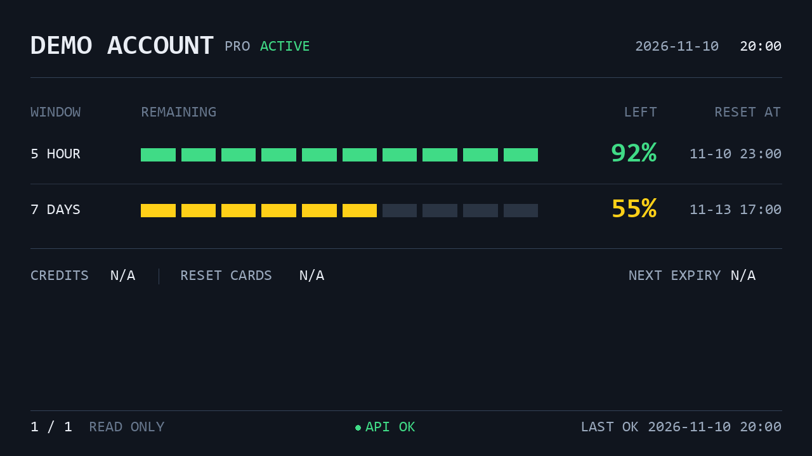

# auxdisp-codex-quota

[中文版](https://github.com/pkuimyy/auxdisp/blob/main/apps/auxdisp-codex-quota/README.md)

Put multiple Codex accounts’ remaining quotas on a desktop auxiliary display: rotate 5-hour / 7-day quotas, reset times, date, and clock. Designed for Windows and Turing USB 5.2-inch displays, with CLI management and no source checkout required.

## Screenshot



**Demo: a 1280×720 offline preview with synthetic data, not a device photo.** Generated by the current renderer without real account identities. [Provenance and reproduction](https://github.com/pkuimyy/auxdisp/blob/main/docs/assets/README.md).

## Features

- Multiple accounts rotate every 15 seconds by default; read-only collection runs every 60 seconds.
- 5-hour / 7-day remaining percentages, ten-segment bars, reset times, and a fixed date/clock.
- Global or per-account collection failures retain history with API ERROR / STALE indicators; USB reconnects automatically.
- Current-user Windows background task, single-instance protection, CLI lifecycle management, and device-free preview / PNG output.

The app only runs `codex-auth list --api --json`. It does not automatically switch accounts, consume Reset Cards, purchase credits, or modify authentication information, and does not read or store authentication tokens. codex-auth manages its own cache and authentication.

## Requirements

- **Windows + Python 3.11+**; background tasks require the user to be logged in and do not run as SYSTEM or elevated administrators.
- [codex-auth](https://github.com/Loongphy/codex-auth) installed separately, with accounts configured for the current user and JSON API schema 1 support. Verify `codex-auth list --api --json` in a terminal first; its output contains account identities and should not be shared. See that project for npm installation and login instructions.
- **Turing USB 5.2 inch**: VID `0x1CBE` / PID `0x0050`, fixed 1280×720 landscape, with an accessible Windows USB interface driver.

`auxdisp-driver` and the user-space libusb dependency are installed automatically; they do not install or replace the Windows device interface driver. Offline Demo previews do not require accounts or a device.

## Installation

Packages are published on [PyPI](https://pypi.org/project/auxdisp-codex-quota/):

```powershell
pip install auxdisp-codex-quota
```

Use a Python environment you intend to keep; removing it breaks the background task. Installation only adds the package and CLI and does not register a task.

## Quick start

```powershell
auxdisp-codex-quota start
auxdisp-codex-quota status
auxdisp-codex-quota stop
```

The first `start` registers and launches a current-user task. Defaults are 30% brightness, 15-second rotation, and 60-second collection. `status` returns JSON: `process_running` and `usb_connected` are separate because a running process does not prove a connected display.

Without hardware, generate a synthetic preview or run an offline rotation for 60 seconds:

```powershell
auxdisp-codex-quota --preview preview.png
auxdisp-codex-quota run --demo --headless latest.png --duration 60
```

Use `auxdisp-codex-quota run` for foreground debugging and Ctrl+C to exit; omitting the subcommand also means `run`. Foreground and background Windows runtimes share an instance lock, so `stop` before foreground debugging.

## Background operation and updates

| Command | Behavior |
|---|---|
| `start` | Register or reconcile the current-user task and launch it; repeated calls do not create another instance |
| `status` | Report registration, enablement, process, USB, and last successful collection |
| `stop` | Disable logon startup and crash retries, then stop the instance |
| `restart` | Stop and start again, reloading configuration |
| `uninstall-service` | Stop and remove the current-user task, preserving configuration and logs |

The background task is independent of its launching terminal and runs while the user is logged in, rather than as a pre-login system service. Full terminal closure, logon/resume, battery behavior and long-duration operation still require acceptance.

To update, stop first, upgrade the package in the same Python environment, then start:

```powershell
auxdisp-codex-quota stop
pip install --upgrade auxdisp-codex-quota
auxdisp-codex-quota start
```

Upgrading alone does not restart a running process; if upgraded while running, use `restart`. Also restart after configuration changes. Repeat an explicit `--config` path when using `start` / `restart`. [Background details, logs, and recovery](https://github.com/pkuimyy/auxdisp/blob/main/apps/auxdisp-codex-quota/docs/en/background.md).

## Configuration

Default file: `%LOCALAPPDATA%\auxdisp-codex-quota\config.toml`. The first `start` creates a comment-only default configuration without overwriting existing files.

Adjust brightness, collection/rotation intervals, fonts, and explicit policies keyed by stable account ID. An explicit `--config <path>` overrides the user default file, followed by built-in defaults. The working directory is not searched.

Logs: `%LOCALAPPDATA%\auxdisp-codex-quota\logs\service.log`, 1 MiB per file with three backups. [Full settings and examples](https://github.com/pkuimyy/auxdisp/blob/main/apps/auxdisp-codex-quota/docs/en/usage.md).

## Understanding the display

| Field | Meaning |
|---|---|
| `5 HOUR` / `7 DAYS` | Identified by 300 / 10080-minute windows, not by primary/secondary position |
| `REMAINING` / `LEFT` | Remaining quota, not usage; each segment represents 10%, rounded up |
| `RESET AT` | Reset time for that window in the local timezone |
| `NOT LIMITED` | An explicitly configured account policy; never inferred from missing data |
| `UNAVAILABLE` / `DATA UNAVAILABLE` | No usable data for that window; neither zero nor unlimited |
| `STALE` | Collection failure or cached data; values may be outdated |
| `API OK` / `API ERROR` | Latest request and current-account refresh status; OK does not guarantee every window exists |
| `LAST OK` | Last successful overall collection, not each account’s source-data timestamp |
| `CREDITS` | Not connected; `N/A` is not a real balance |
| `RESET CARDS` | Not connected; `N/A` is not a card count |
| `NEXT EXPIRY` | Not connected; `N/A` does not provide an expiry time |

## Troubleshooting

For missing CLI / codex-auth commands, USB discovery, blank screens, API ERROR / STALE, missing windows, or background startup failures, follow the [troubleshooting guide](https://github.com/pkuimyy/auxdisp/blob/main/apps/auxdisp-codex-quota/docs/en/troubleshooting.md). [Issues](https://github.com/pkuimyy/auxdisp/issues).

## Uninstallation

```powershell
auxdisp-codex-quota stop
auxdisp-codex-quota uninstall-service
pip uninstall auxdisp-codex-quota
```

Removing the package and deleting user data are separate operations. These steps preserve configuration, logs, diagnostics, and codex-auth accounts. Delete personal data only if you choose to do so.

## Limitations and verification scope

Currently targets one Turing USB 5.2-inch display at 1280×720 landscape. On 2026-11-11, PyPI 0.1.0 passed a 75-second foreground run with real collection, rotation and user-confirmed display/NOT LIMITED behavior; see the [hardware record](hardware-testing.md). Pre-release builds of 0.1.2 additionally passed [installed CLI acceptance](windows-installation-verification.md) for user-level pip, venv and uv tool. Logon/resume and long-duration stability remain unverified; other models are outside scope. A publishable device photo is not yet available.

For development, see [local development](https://github.com/pkuimyy/auxdisp/blob/main/docs/en/development.md). Licensed under [GPL-3.0-or-later](https://github.com/pkuimyy/auxdisp/blob/main/apps/auxdisp-codex-quota/LICENSE). [codex-auth](https://github.com/Loongphy/codex-auth) is an independent data source. AuxDisp is not an official OpenAI product.
