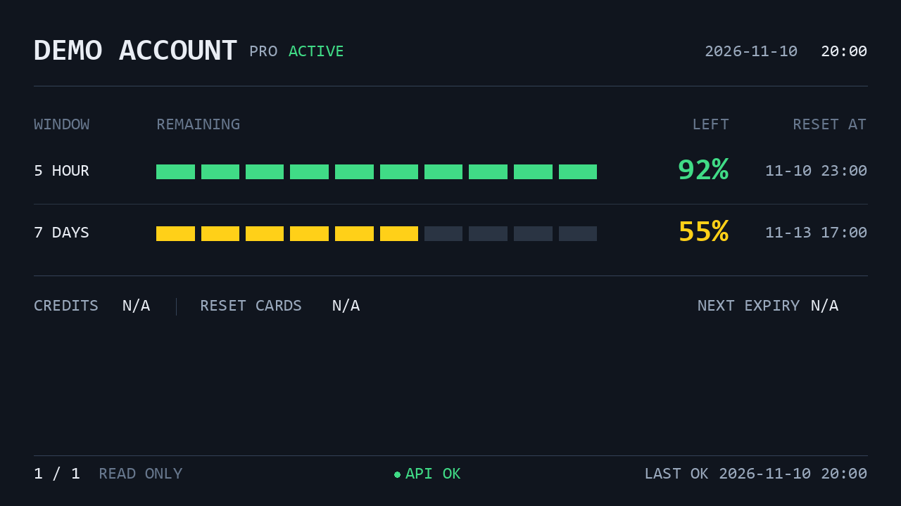

# AuxDisp

[简体中文](../../README.md)

AuxDisp provides Python drivers and ready-to-use applications for USB / serial auxiliary displays. Build a small information screen yourself, or install **auxdisp-codex-quota** to rotate the remaining quotas of multiple Codex accounts on a desktop display.

## Preview



**Demo with synthetic accounts, not a device photograph.** Generated offline by the current renderer, without real account data. See [provenance and reproduction](../assets/README.md). A publishable physical-device photo is still needed.

## Features

- **auxdisp-driver** preserves eight implementations, including a simulator: send Pillow images over USB or serial, control supported brightness and orientation, and access device-specific APIs.
- **auxdisp-codex-quota** displays multiple accounts' 5-hour / 7-day remaining quotas, reset times, date, and clock. Defaults: rotate every 15 seconds and collect every 60 seconds.
- Collection failures retain history with error indicators; USB output reconnects automatically. Windows supports background operation and CLI lifecycle management.

CREDITS, RESET CARDS, and NEXT EXPIRY are not connected and show `N/A`. The application only reads quotas; it does not automatically switch accounts, consume reset cards, purchase credits, or modify authentication information.

## Choose a project

| Project | For | Purpose and installation |
|---|---|---|
| [auxdisp-driver](../../packages/auxdisp-driver/docs/en/README.md) | Python developers | Control auxiliary displays · [PyPI](https://pypi.org/project/auxdisp-driver/) |
| [auxdisp-codex-quota](../../apps/auxdisp-codex-quota/docs/en/README.md) | Codex users | Display account quotas · [PyPI](https://pypi.org/project/auxdisp-codex-quota/) |

Both packages have a published 0.1.0 release. Installing the application installs the released driver dependency from PyPI; source checkouts are unnecessary.

## Quick start

### Use auxdisp-codex-quota

Requirements: **Windows, Python 3.11+**, [codex-auth](https://github.com/Loongphy/codex-auth) installed with accounts configured for the current user, and an accessible **Turing USB 5.2-inch** display (VID `0x1CBE` / PID `0x0050`, 1280×720 landscape). Windows needs a compatible USB interface driver; the Python package does not replace system drivers.

```powershell
pip install auxdisp-codex-quota
auxdisp-codex-quota start
auxdisp-codex-quota status
auxdisp-codex-quota stop
```

Installation does not register a task; the first `start` registers and launches a current-user scheduled task. It can continue after the terminal closes and only runs while that user is logged in. `stop` also disables logon startup and crash retries; use `start` to enable them again. See [background operation and updates](../../apps/auxdisp-codex-quota/docs/en/background.md).

Without a device or accounts, try an offline Demo:

```powershell
auxdisp-codex-quota --preview preview.png
```

To uninstall, stop and remove the task first. Configuration and logs are preserved:

```powershell
auxdisp-codex-quota stop
auxdisp-codex-quota uninstall-service
pip uninstall auxdisp-codex-quota
```

### Develop with auxdisp-driver

Requires Python 3.9+ and a device matching the chosen protocol:

```powershell
pip install auxdisp-driver
```

This Turing USB example draws and sends a Pillow image, then releases the device:

```python
from PIL import Image, ImageDraw
from auxdisp_driver import Orientation, open_display

with open_display("turing_usb", orientation=Orientation.LANDSCAPE) as display:
    display.set_brightness(30)
    image = Image.new("RGB", (display.width, display.height), "navy")
    ImageDraw.Draw(image).text((24, 24), "Hello AuxDisp", fill="white")
    display.show(image)
```

See [device selection, discovery, and device-specific APIs](../../packages/auxdisp-driver/docs/en/README.md).

## Hardware and platforms

auxdisp-driver includes Rev A/B/C/D, Turing USB, WeAct A/B, and a simulator. **Protocol coverage is not hardware acceptance.** A Turing USB 5.2-inch clear-screen fix is documented, but the full Windows hardware matrix remains unverified; code coverage does not establish compatibility for other models. See [supported devices and verification scope](../../packages/auxdisp-driver/docs/en/supported-devices.md).

The driver can be installed on Windows, Linux, and macOS; device permissions, backend operation, and model compatibility require separate checks. `libusb-package` supplies a user-space library, distinct from the Windows USB interface driver. Linux also requires device access permissions. auxdisp-codex-quota background management targets Windows; offline previews on other systems do not establish USB or background support.

## Configuration

The application defaults to `%LOCALAPPDATA%\auxdisp-codex-quota\config.toml`; use `--config` for another file. Common settings include brightness (30%), rotation (15 seconds), collection (60 seconds), font files, and explicit quota policies keyed by stable account ID. Run `auxdisp-codex-quota restart` after changes. See [configuration](../../apps/auxdisp-codex-quota/docs/en/usage.md).

## Troubleshooting

| Symptom | Check first |
|---|---|
| CLI not found | Python environment and its Scripts directory on PATH |
| codex-auth not found | Availability in the same user's terminal, or a configured native exe path |
| USB not detected | Model, VID/PID, cable, interface driver, and access permissions |
| Connected but blank | Process/USB fields in `status`, foreground `run` logs, and brightness |
| API ERROR / STALE | Read-only codex-auth query, network, and account refresh status |
| UNAVAILABLE | Whether the data source supplies that window; missing is not zero |
| Background startup fails | Task policy, installed interpreter, and user logs |
| Unsure how to manage it | `start` launches, `status` checks, `stop` stops and disables automatic startup |

See [application troubleshooting](../../apps/auxdisp-codex-quota/docs/en/troubleshooting.md) and the [driver guide](../../packages/auxdisp-driver/docs/en/usage.md). For further help, open an [Issue](https://github.com/pkuimyy/auxdisp/issues) after removing account identifiers and credentials.

## Development and contributing

This Monorepo contains two independently released Python packages, with separate uv development environments. Issues and Pull Requests are welcome. See [development](development.md) and [architecture](architecture.md).

## Credits and license

Drivers are primarily derived from [turing-smart-screen-python](https://github.com/mathoudebine/turing-smart-screen-python) by Matthieu Houdebine and contributors. [smartscreen-driver](https://github.com/hchargois/smartscreen-driver) was consulted only for API and packaging organization. See [NOTICE](../../packages/auxdisp-driver/NOTICE.md) and the [GPL-3.0-or-later license](../../LICENSE).

[codex-auth](https://github.com/Loongphy/codex-auth) is an independent project providing quota data. AuxDisp is a community project, not an official OpenAI product.
